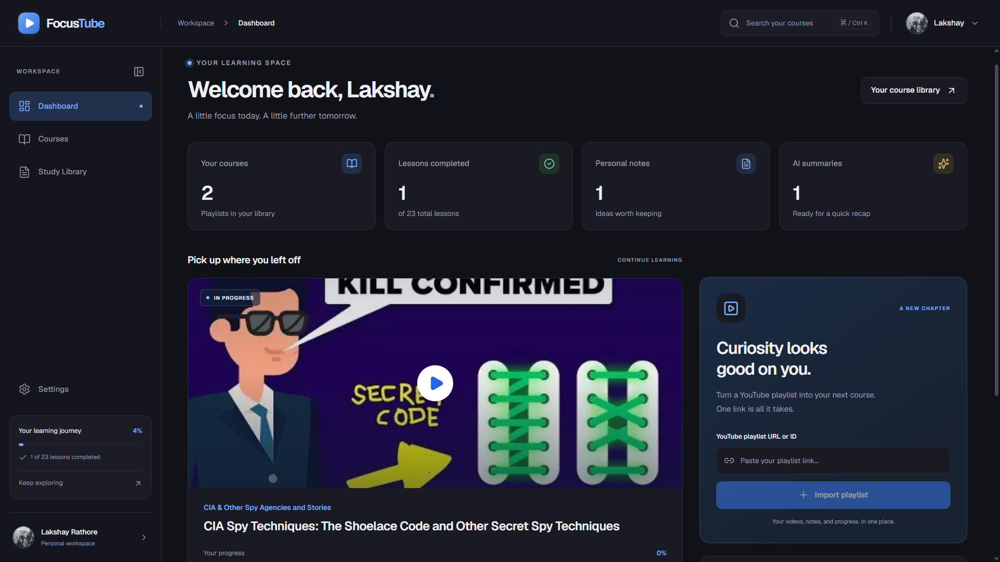

# FocusTube

**Turn YouTube playlists into a focused learning workspace.**

### [Open FocusTube — Live App](https://focustube-v2.vercel.app/)

Watch lessons, track your progress, take rich text notes, and study with AI summaries, quizzes, and transcript-grounded video chat.



## Table of contents

- [Features](#features)
- [Tech stack](#tech-stack)
- [Project structure](#project-structure)
- [Local setup](#local-setup)
- [Start the backend](#start-the-backend)
- [Start the frontend](#start-the-frontend)
- [Enable video chat](#enable-video-chat)
- [Development commands](#development-commands)
- [Troubleshooting](#troubleshooting)
- [Deployment](#deployment)
- [Documentation](#documentation)

## Features

- **Playlist courses:** Import YouTube playlists as courses and sync their lessons.
- **Progress tracking:** Resume videos, mark lessons complete, and review learning statistics on your dashboard.
- **Personal notes:** Write and revisit rich text notes alongside each video.
- **AI study material:** Generate summaries and quizzes from video transcripts.
- **Ask AI:** Ask questions about a video's transcript and inspect the retrieved source passages. Requires the optional video-chat setup below.
- **Study Library:** Search and filter saved notes, summaries, and quizzes across courses.
- **Google sign-in:** Keep your courses and study resources connected to your account.

## Tech stack

| Layer | Technologies |
| --- | --- |
| Frontend | Next.js 16, React 19, TypeScript, Tailwind CSS 4 |
| Notes editor | Tiptap |
| Backend | FastAPI, Python 3.12+, Uvicorn |
| Database | PostgreSQL / Neon, SQLAlchemy, psycopg, Alembic |
| Authentication | Google OAuth/OIDC through Authlib, database-backed sessions |
| Content and AI | YouTube Data API, Supadata transcripts, Google Gemini |
| Video retrieval | pgvector, local MiniLM embeddings through FastEmbed/ONNX |
| Checks | ESLint, TypeScript, Vitest, Ruff, pytest |

Next.js handles the interface and forwards browser `/api/*` requests to FastAPI. FastAPI owns authentication, authorization, database access, and provider calls. Database and provider credentials stay on the backend.

## Project structure

```text
focustube/
├── frontend/              Next.js application
│   ├── src/app/           Pages, layouts, and styles
│   ├── src/components/    UI grouped by feature
│   ├── src/lib/           Frontend helpers and backend integration
│   ├── public/            Static assets
│   └── .env.example       Frontend configuration template
├── backend/               FastAPI application
│   ├── app/               Routers, services, models, and configuration
│   ├── migrations/        Alembic database migrations
│   ├── scripts/           Operational and provider checks
│   ├── tests/             Backend tests
│   └── .env.example       Backend configuration template
├── docs/                  Project guides and historical notes
├── package.json           Root npm workspace commands
└── package-lock.json      Shared npm lockfile
```

Run frontend npm commands from the repository root. Python commands run from `backend/` unless stated otherwise. See the [full project structure](docs/PROJECT_STRUCTURE.md) for a detailed code map.

## Local setup

The commands below use **Windows PowerShell** and native processes; Docker is not required.

### 1. Prerequisites

- Node.js compatible with Next.js 16, with npm.
- Python **3.12 or newer** and `uv`.
- A separate PostgreSQL database, such as a new Neon database. Video chat also requires pgvector support.
- Google OAuth credentials, a YouTube Data API key, and Supadata/Gemini API keys for transcript and AI features.

### 2. Install dependencies

From the repository root:

```powershell
npm ci
uv sync --project backend
```

Python dependencies are installed into `backend/.venv/`.

### 3. Configure environment files

Create local files from the templates without overwriting existing configuration:

```powershell
if (!(Test-Path frontend/.env.local)) {
    Copy-Item frontend/.env.example frontend/.env.local
}
if (!(Test-Path backend/.env)) {
    Copy-Item backend/.env.example backend/.env
}
```

In `frontend/.env.local`:

```dotenv
BACKEND_URL=http://127.0.0.1:8000
NEXT_PUBLIC_APP_VERSION=2.0.0
```

In `backend/.env`, configure the following:

| Variable | Purpose / local value |
| --- | --- |
| `DATABASE_URL` | Your separate PostgreSQL connection URL using `postgresql+psycopg://`; retain required TLS parameters |
| `FRONTEND_ORIGIN` | `http://localhost:3000` |
| `AUTH_SECRET` | A random secret of at least 32 characters; preserve an existing secret |
| `COOKIE_SECURE` | `false` for local HTTP; `true` for HTTPS |
| `SESSION_DAYS` | Session lifetime; defaults to `7` |
| `GOOGLE_CLIENT_ID`, `GOOGLE_CLIENT_SECRET` | Google OAuth client credentials |
| `YOUTUBE_API_KEY` | YouTube Data API v3 key |
| `SUPADATA_API_KEY` | Transcript provider key |
| `GEMINI_API_KEY` | Gemini generation key |
| `GEMINI_MODEL` | Primary generation model; see the backend template for the current default |
| `GEMINI_FALLBACK_MODEL` | Alternate generation model; set empty to disable fallback |
| `RAG_ENABLED` | `false` by default; enable after completing video-chat setup |
| `RAG_EMBEDDING_MODEL` | Defaults to `sentence-transformers/all-MiniLM-L6-v2` |

Both environment files are ignored by Git. Never commit credentials or put backend secrets in frontend configuration. The optional ignored `backend/.env.legacy.local` is used only by the database safety preflight; application runtime does not load it.

### 4. Prepare the database

Use a **separate database for FastAPI** and confirm the configured host/database before applying migrations. The localhost port `5433` URL in the template is a placeholder, not a provisioned database. The archived Prisma/Neon database must remain untouched; no data migration from it is required.

From `backend/`, after confirming the target:

```powershell
.\.venv\Scripts\python.exe -m alembic upgrade head
.\.venv\Scripts\python.exe -m alembic current
.\.venv\Scripts\python.exe -m alembic check
```

Migrations create the application schema and video-retrieval tables. Never reset, wipe, drop, truncate, or apply a migration that requires data loss. See [migration status](docs/MIGRATION_STATUS.md) and [RAG status](docs/RAG_STATUS.md) for existing setup and verification details.

### 5. Configure Google sign-in

Register this exact authorized redirect URI on your Google OAuth client:

```text
http://localhost:3000/api/auth/callback/google
```

Use `http://localhost:3000` consistently in your browser so the origin, cookies, and callback agree.

## Start the backend

Open a terminal at the repository root and run:

```powershell
cd backend
.\.venv\Scripts\python.exe -m uvicorn app.main:app --host 127.0.0.1 --port 8000 --reload --no-access-log --loop app.runtime:database_event_loop
```

Keep this terminal running. The custom event loop supports async psycopg on Windows. `--no-access-log` keeps OAuth callback query strings out of Uvicorn access logs; the application provides sanitized request logs.

| Local endpoint | Purpose |
| --- | --- |
| [Backend health](http://127.0.0.1:8000/api/health) | Check that FastAPI is running |
| [Database readiness](http://127.0.0.1:8000/api/health/ready) | Check database connectivity |
| [API documentation](http://127.0.0.1:8000/docs) | Explore the generated OpenAPI reference |

Mutating API requests require an `Origin` matching `FRONTEND_ORIGIN`. Swagger requests from port `8000` will fail this check with the default local configuration; use the app for authenticated workflows and keep Origin protection enabled.

## Start the frontend

Open a **second terminal** at the repository root:

```powershell
npm run dev
```

Visit **[http://localhost:3000](http://localhost:3000)**. Both servers must stay running for the local app to work.

Sign in with Google, import a YouTube playlist in **Courses**, and open a lesson to begin. Your saved notes and AI study material are available in **Study Library**.

## Enable video chat

Video chat is optional and uses local embeddings to retrieve relevant transcript passages, then Gemini to generate answers.

1. Apply the latest database migrations to the confirmed database target.
2. From `backend/`, download the embedding model once:

   ```powershell
   .\.venv\Scripts\python.exe -m scripts.setup_embeddings
   ```

3. Set `RAG_ENABLED=true` in `backend/.env` and restart the backend.
4. Open **Ask AI** for a course video and select **Prepare video chat** when prompted.

Model files are cached in ignored `backend/.cache/embeddings/`. Existing indexes created with an older embedding model need preparation again. Local embeddings do not require an embedding API key; Gemini answers still consume provider quota. Chat history stays in browser memory for the open workspace.

Read [RAG explained simply](docs/RAG_GUIDE.md) for the flow, source citations, configuration, and current limitations.

## Development commands

From the repository root:

```powershell
npm run typecheck
npm run lint
npm run test
npm run build
```

To serve a production frontend build locally, run `npm run start` after a successful build and keep the backend running separately. Builds download the configured Google fonts and need network access.

From `backend/`:

```powershell
.\.venv\Scripts\ruff.exe check app tests migrations scripts
.\.venv\Scripts\ruff.exe format --check app tests migrations scripts
.\.venv\Scripts\python.exe -m pytest -q
```

Backend tests use isolated temporary SQLite databases and mocked providers. They do not prove real PostgreSQL migration, locking/concurrency, Google OAuth, or provider behavior. See [verification status](docs/MIGRATION_STATUS.md) for recorded results, the existing frontend lint backlog, and outstanding manual checks.

## Troubleshooting

| Problem | What to check |
| --- | --- |
| Frontend cannot reach the API | Start the backend on port `8000`, check `BACKEND_URL`, and open `/api/health/ready` through the frontend. |
| Google login fails | Match the redirect URI exactly and use `localhost:3000` consistently. Check backend OAuth credentials. |
| Database connection fails | Replace the template URL, retain required TLS parameters, and confirm migrations against the intended target. |
| Video chat needs preparation | Download the local embedding model, enable RAG, restart the backend, and prepare the selected video. |
| AI request fails or hits quota | Check provider configuration, quota, and the displayed error. Local embeddings do not remove Gemini generation limits. |
| Build cannot download fonts | Allow network access for the Next.js build process. |

For more operational checks, see the [development guide](docs/DEVELOPMENT.md).

## Deployment

The deployed app is available at **[focustube-v2.vercel.app](https://focustube-v2.vercel.app/)**.

For hosting changes or your own deployment, follow the [deployment guide](docs/DEPLOYMENT_GUIDE.md). The Next.js application lives in `frontend/`; FastAPI runs as a separate backend service. Keep provider/database credentials on that service and configure HTTPS origins, secure cookies, and the production Google OAuth callback for your deployment.

## Documentation

| Guide | Contents |
| --- | --- |
| [Documentation index](docs/README.md) | All current guides in one place |
| [Development guide](docs/DEVELOPMENT.md) | Local workflow and operational checks |
| [Project structure](docs/PROJECT_STRUCTURE.md) | Detailed folder and code map |
| [Architecture](docs/ARCHITECTURE.md) | Frontend/backend responsibilities and data flows |
| [API reference](docs/API.md) | Routes, authentication, and response contracts |
| [RAG guide](docs/RAG_GUIDE.md) | How transcript-grounded video chat works |
| [RAG status](docs/RAG_STATUS.md) | Retrieval verification and remaining limitations |
| [Migration status](docs/MIGRATION_STATUS.md) | Database migration and verification history |
| [Deployment guide](docs/DEPLOYMENT_GUIDE.md) | Hosting setup and safe deployment changes |
| [Session handoff](docs/development/SESSION_HANDOFF.md) | Development continuation notes |

Historical Prisma/Auth.js material is preserved under `docs/archive/legacy/`. Use the current guides and source files for the active Next.js + FastAPI implementation.
