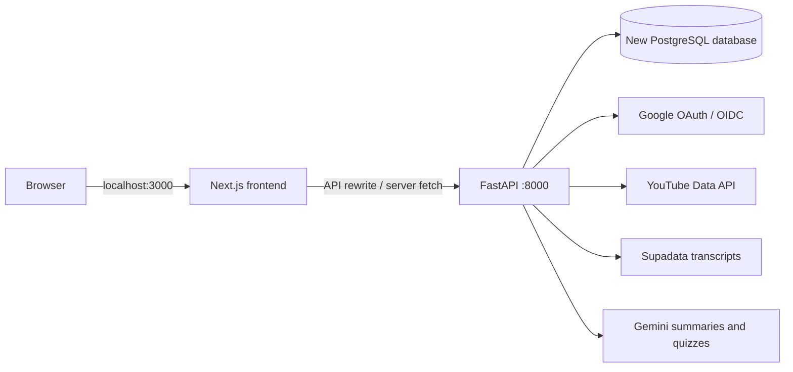

# Current FastAPI migration architecture

Next.js 16 / React 19 renders the application and proxies browser API requests. FastAPI is the sole active owner of authentication, business APIs, PostgreSQL, YouTube, Supadata, and Gemini. This document describes implemented code, not proof of a completed production cutover.

## Code map

| Path | Responsibility |
| --- | --- |
| `backend/app/config.py` | Validated settings from `backend/.env` |
| `backend/app/database.py` | Async SQLAlchemy sessions using psycopg |
| `backend/app/models.py` | Current database models and constraints |
| `backend/migrations/versions/0001_initial.py` | Explicit initial schema for a new empty target |
| `backend/app/main.py` | Routers, Origin validation, errors, sanitized JSON logs, health |
| `backend/app/dependencies.py` | Hashed-session lookup and ownership checks |
| `backend/app/routers/` | Auth, courses, videos, notes, statistics, AI |
| `backend/app/services/` | External provider adapters |
| `backend/tests/` | SQLite API/identity tests and mocked provider tests |
| `frontend/src/lib/backend.ts` | Server API fetches, session lookup, authenticated redirects |
| `frontend/src/components/auth/` | Client auth state and protected server layout |
| `frontend/next.config.ts` | API rewrite and 120-second proxy timeout |
| `package.json` | npm workspace shortcuts; frontend dependencies are declared in `frontend/package.json` |
| `docs/archive/nextjs-ai-content.ts.txt` | Preserved pre-existing AI route comments/code |

## Identity and ownership

Authlib handles Google OAuth/OIDC state and identity validation. Only verified email identities are accepted. Accounts are matched by Google provider subject; matching email alone never links identities. A successful login rotates the presented application session.

The browser receives an opaque session token in `focustube_session`; only its SHA-256 hash and expiry are stored in PostgreSQL. Cookies are HttpOnly, SameSite=Lax, path `/`, and Secure when configured for HTTPS. Temporary OAuth state uses the signed `focustube_oauth` cookie with a ten-minute lifetime. Logout revokes the presented token and clears cookies.

Every data API verifies the session and ownership. Access to shared AI cache entries also requires an owned video. Server fetches forward only the app session cookie and use `no-store`. Client auth state is checked again on pathname changes. Backend authorization remains authoritative even when a frontend layout is reused during navigation.

## Data and imports

The schema contains users, accounts, sessions, courses, videos, notes, and shared AI content. IDs are UUID strings. Models use snake_case columns; JSON responses preserve camelCase fields and `_count` aggregates.

Course import fetches paginated playlist entries, deduplicates YouTube video IDs, skips private/deleted entries, and writes course/videos transactionally. A user cannot import the same playlist twice. Sync locks the course row, updates metadata, inserts new videos, and archives missing videos with `is_available=false`, preserving their notes and progress. Course deletion cascades to its videos and notes while leaving globally shared AI content intact.

Notes retain the existing rich text HTML format. Blank rich text is rejected. Playback position must be an integer within range or null to clear it; status cannot be null.

## AI pipeline

AI content is globally keyed by YouTube video ID; unlock timestamps belong to each user's video row. The request first checks ownership, then reuses ready content or atomically claims a generation attempt. Claims expire after two minutes, have unique claim IDs, and allow at most three attempts. Conditional updates are evaluated by the database, avoiding Python-side comparison of SQLite naive timestamps with aware UTC timestamps.

No database transaction is held during the provider pipeline. Supadata returns native transcript text; the full transcript is stored, while only the first 20,000 characters are sent to Gemini. Retries reuse a saved transcript. Pydantic validates the summary and four-option quiz shape. Generation is bounded to 90 seconds; configured model failover uses a shorter primary deadline and bounds output size. Outage/configuration/timeout failures refund the claim attempt, while genuine content failures retain the three-attempt cap. A worker can publish only while its claim ID is still current; a replaced worker cannot overwrite results or unlock content.

Course polling runs at most 45 checks every two seconds; workspace polling runs at most 30 checks every three seconds. Each allows only one polling request at a time and stops on success, failure, or exhausted checks. Requests have a 100-second client timeout. This is synchronous request-based generation, not a durable job system.

## Scope and limits

The archived database is never a migration target. No data backfill is planned. New Neon schema alignment, real Google login, core API persistence, and real AI generation have been verified separately from unit tests. PostgreSQL claim concurrency, live playlist import/sync, and a complete browser walkthrough remain pending; see [verification status](MIGRATION_STATUS.md). Tests against SQLite do not prove those properties.

Video transcript RAG is implemented separately from summary generation. See the beginner-friendly [RAG guide](RAG_GUIDE.md) and [verification status](RAG_STATUS.md). Course-wide and personal-note retrieval, timestamped ingestion, worker queues and deployment remain deferred.

## Video transcript RAG

`routers/rag.py` checks session/ownership and input bounds. `services/rag.py` claims preparation, reuses/fetches the full transcript, chunks it with overlap, atomically publishes embeddings and retrieves six passages from the selected document. `services/local_embeddings.py` owns cached CPU MiniLM embeddings and complete token-window pooling. `services/rag_provider.py` delegates embeddings locally and owns bounded Gemini follow-up rewriting and structured answer generation. Migration `0003` allows variable vector dimensions without changing existing values. Migration `0002` adds pgvector and the independent `rag_documents`, `rag_chunks`, `rag_rate_limits` tables.

Five-minute claims and guarded publication prevent stale requests from replacing an index. Provider calls run outside transactions; preparation is request-bound to 90 seconds. A database upsert enforces ten per-user mutation requests per minute across processes. Questions/answers are not persisted. The 60-second answer pipeline treats history/transcripts as untrusted data, validates source IDs and constructs citation metadata server-side. Citation validation does not prove factual support; manual assessment remains necessary.

Courses provides video chat independently of AI unlocks. Study Library replaces the former Learning hub with a cross-course browser of saved personal notes, summaries, and quizzes. Its authenticated backend endpoint applies ownership and per-video AI unlock checks before returning resource metadata. Opening a saved resource reuses the shared study workspace and never starts AI generation. Chat remains attached to the workspace's video and is not a saved library item.

Capability discovery hides chat when `RAG_ENABLED=false` (the source default). Conversation state stays in browser memory until workspace closure/video switching; aborted/late requests cannot populate the next video's chat. The workspace uses a modal dialog with contained keyboard focus. Pending note edits are flushed before tab changes or closure; failed saves keep the editor open for retry.

AI generation progress uses the existing transcript/status/claim fields rather than a new table or stage column. The current claim commits the full transcript before Gemini generation; a replaced claim cannot advance or generate. An ownership-checked read-only `/videos/{id}/ai-progress` endpoint returns only stage/status. The shared `AiGenerationProgress` client component polls this endpoint during both the initial long POST and pending work, with bounded sequential requests and unmount cancellation. It is used by course rows and the Summary/Quiz workspace.
