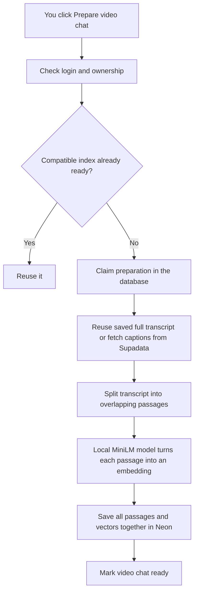
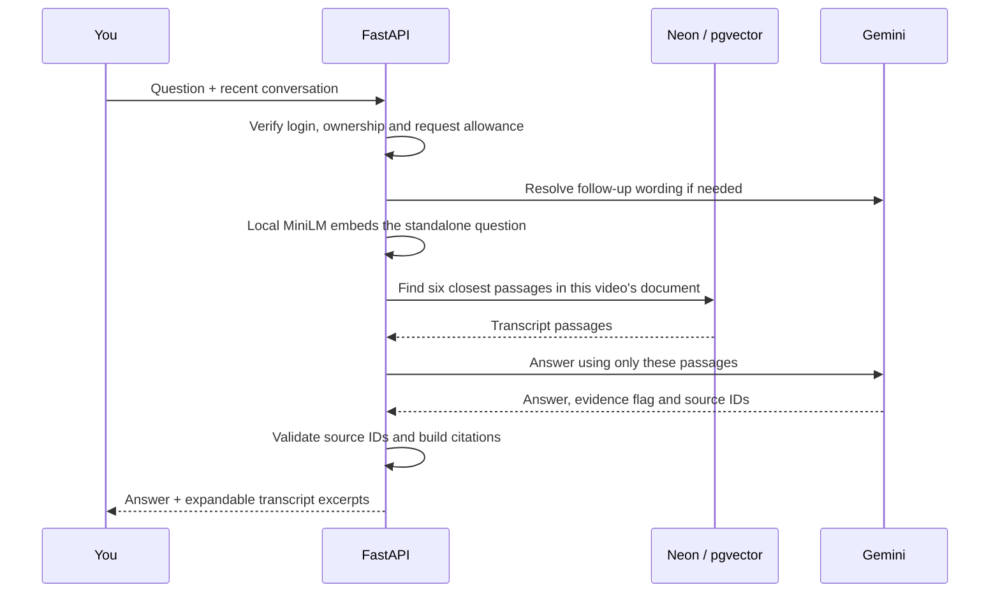

# How video chat works in FocusTube

RAG means **Retrieval-Augmented Generation**. In everyday language: **find useful parts of the video transcript, then ask the AI to answer using those parts**.

Think of an open-book exam. The transcript is the textbook. Retrieval finds the relevant pages. Gemini writes an answer with those pages in front of it. The excerpts under the answer let you check its work.

This feature answers questions about **one selected video**. You can use it before generating a summary or completing the video.

## Try it

The quickest way: open **Courses → your course** and click the blue **Ask AI** button beside a video's Play, study notes and personal notes actions. This opens that video's Ask AI tab directly; no summary is required. Close the workspace to return to the course list.

Alternatively, open a saved resource in **Study Library** and select **Ask AI** for that resource's video. The shared workspace has Ask AI alongside Personal notes, AI summary, and Quiz when video chat is enabled by the backend. Chat is video-specific and is not stored as a library item.

1. Click **Prepare video chat**. This fetches and indexes the transcript if needed. Preparing a video can take longer than asking a question.
2. Ask something specific about the lesson. For example, “Why does the instructor use this approach?”
3. Expand the sources under the answer and compare the explanation with the transcript passages. The video link opens the original video; there are no timestamp links in this version.
4. Ask a follow-up such as “Can you explain that example?” The chat uses recent messages to interpret “that.”

The chat has suggested starter questions, separate question/answer bubbles and expandable transcript source cards. The question box stays visible while messages scroll in their own pane with a dark scrollbar. It starts as one line and grows to a fixed limit for longer questions. The top-right X closes the workspace. Press **Enter** to send or **Shift+Enter** for a new line. While an answer is being prepared, your question appears in the conversation with a working indicator. If it fails, the question remains in the box for retry.

Closing the workspace clears the conversation. The prepared transcript remains in the database, so reopening the same video usually needs no new preparation. Switching between workspace tabs keeps the conversation while that workspace stays open.

## Part one: preparing the video



A **chunk** is a small passage of transcript. We target 2,400 characters per chunk and overlap adjacent chunks by about 400 characters. The overlap helps when an explanation crosses a boundary. We prefer sentence endings, then whitespace. Very long unbroken text still gets split. Character offsets record exactly where a passage came from.

An **embedding** is a list of numbers representing the meaning of a passage. Similar meanings tend to produce similar lists. FocusTube uses **MiniLM L6 v2 locally on your CPU**, with 384 numbers per passage. These numbers help search; they are not summaries or answers. No Google API call is made for embeddings.

**pgvector** adds vector storage and comparison to PostgreSQL. Neon is still our database; we did not add a separate vector database. We normalize vectors to unit length consistently for documents and questions. [MiniLM L6 v2](https://huggingface.co/sentence-transformers/all-MiniLM-L6-v2) is Apache-2.0-licensed and designed for English retrieval. It runs through FastEmbed/ONNX, without a separate embedding server or GPU.

MiniLM accepts up to 256 tokens per input. To preserve a whole passage, we split its tokens into windows of at most 240 tokens, embed every window, combine them using token-count weights, and normalize the resulting vector. Questions and passages use the same encoder without a retrieval prefix. Citations still show the exact original transcript passage. This avoids silently dropping the end of a passage. This English model is best suited to English captions; Hindi and other-language retrieval has not been evaluated.

The whole transcript is indexed, including text after character 20,000. The existing summary pipeline still uses its own 20,000-character input limit. Chat does not rely on that summary.

## Part two: answering your question



For “Why did it fail?”, a short rewriting step may use the recent conversation to identify what “it” means. If rewriting fails, the system searches with the original question. History helps interpret your question; it is never treated as transcript evidence.

Retrieval uses **cosine distance**: a comparison of vector direction. Lower distance means closer meaning. We search exactly within the selected video's chunks and take up to six. There is no approximate search index yet; the smaller scope makes exact search a reasonable first implementation ([pgvector Python documentation](https://github.com/pgvector/pgvector-python)).

The model receives source labels such as `S1` and `S2`. It must return structured data with an answer, whether evidence is sufficient, and the source labels it used. FastAPI rejects unknown labels or an answered result without a citation. Excerpts, titles and URLs are built from server-side records.

## What the database remembers

| Table | What it stores | Why |
| --- | --- | --- |
| `rag_documents` | Full transcript, hash, model/version, preparation status and claim | Reuse work and recover interrupted preparation |
| `rag_chunks` | Ordered passages, source offsets and 384-number embeddings | Find relevant transcript evidence |
| `rag_rate_limits` | Each user's current request-window start and counter | Enforce limits across server processes |

Documents are shared by YouTube video ID to avoid paying to index the same video repeatedly. Sharing storage does **not** share authorization: every status, prepare and ask request checks that the signed-in user owns the application video. Deleting a course removes access through that course, even when the shared index stays cached.

Questions and answers are **not stored by FocusTube**. The browser holds the conversation in memory and sends at most six previous messages per question. The necessary text is sent to the external AI provider to answer the request; memory-only history does not mean provider processing is local.

Preparing chat does not change summaries, quizzes, progress, AI attempts or unlock timestamps.

## What can go wrong

| What you see | Meaning / next step |
| --- | --- |
| Prepare video chat | No compatible index is ready. Prepare it explicitly. |
| Preparing | Another request may be preparing this shared video. Status checks are free. |
| Taking longer | Automatic polling stopped after two minutes. Refresh status later. An abandoned claim becomes retryable after five minutes. |
| Captions unavailable | There is no usable transcript. We cannot answer from missing source material. |
| Not enough transcript evidence | The retrieved passages did not support an answer. Try a more specific question. |
| Request allowance reached | Wait and retry. RAG allows ten mutation requests per user per minute; provider quotas also apply. |
| Technical failure | Retry is safe. A fetched transcript survives embedding failure. Failed questions remain in the input for retry. |

A database **claim** is a temporary reservation: “this request is preparing this document.” Only the current claim can publish. The complete index becomes visible atomically, so users never search a half-built transcript. Provider calls happen outside database transactions. Preparation has a 90-second deadline; the answer pipeline has a 60-second deadline, including rewriting and generation failover.

The browser cancels its requests when the workspace closes or the video changes and discards old responses. Cancellation does not guarantee server work stops. Expiring claims provide recovery if that happens.

## Limits to understand

RAG reduces unsupported answers; it does not guarantee correctness. A valid citation proves the passage was retrieved, **not** that every claim in the answer follows from it. Captions can be inaccurate, retrieval can miss useful passages, and the model can misinterpret them. Check the excerpts and video when accuracy matters.

Transcript instructions and browser history are treated as untrusted input in prompts. That is a safeguard, not proof that all prompt-injection attacks are impossible.

This version has no course-wide search, personal-note retrieval, saved chats, timestamps, uploads, worker queue or deployment setup. Very long videos may exceed the preparation deadline and need a later architecture change; we do not silently index only their beginning.

## Where the implementation lives

| File | Plain-language job |
| --- | --- |
| `backend/app/routers/rag.py` | Receives chat requests, checks access and validates question/history sizes |
| `backend/app/services/rag.py` | Splits transcripts, claims preparation, saves indexes, searches and validates citations |
| `backend/app/services/rag_provider.py` | Delegates embeddings locally; calls Gemini for rewriting and structured answers |
| `backend/app/services/local_embeddings.py` | Cached CPU model, complete token windows and normalized pooling |
| `backend/app/models.py` | Declares the three RAG tables |
| `backend/migrations/versions/0002_video_rag.py` | Adds those tables and enables pgvector |
| `backend/migrations/versions/0003_variable_embedding_dimensions.py` | Retains old vectors while allowing MiniLM dimensions |
| `frontend/src/components/learning/VideoChat.tsx` | Preparation controls, messages, questions, polling, retries and citations |
| `frontend/src/components/learning/LearningWorkspace.tsx` | Shared resource workspace and video-specific Ask AI tab |
| `frontend/src/lib/use-video-chat.ts` | Reads the backend capability so disabled chat stays hidden |
| `backend/tests/test_rag.py` | Isolated behavior/security tests with mocked providers |
| `frontend/tests/video-chat.test.tsx` | Chat interaction, cancellation and polling tests |
| `backend/scripts/check_rag.py` | Explicit live database/embedding availability check |
| `backend/scripts/verify_rag_postgres.py` | Explicit migration/vector/concurrency checks in a dedicated test database |

## Configuration and safe rollout

Backend-only settings belong in ignored `backend/.env`:

```dotenv
RAG_ENABLED=false
RAG_EMBEDDING_MODEL=sentence-transformers/all-MiniLM-L6-v2
```

Chat reuses `GEMINI_API_KEY`, `SUPADATA_API_KEY`, `GEMINI_MODEL` and `GEMINI_FALLBACK_MODEL` for answers/rewriting and captions. Embeddings require no API key. Never put provider keys in frontend variables. Indexes record model, dimensions and chunking version; incompatible indexes must be prepared again. Embedding models never silently fall back to a different model.

After installing backend dependencies, download the model once from `backend/`:

```powershell
.\.venv\Scripts\python.exe -m scripts.setup_embeddings
.\.venv\Scripts\python.exe -m scripts.check_local_embeddings
```

Weights live in ignored `backend/.cache/embeddings/`. Application requests load cached files only; they do not download weights. The offline check makes no Gemini/database calls. CPU inference runs off the async event loop and is limited to one embedding operation per process with one ONNX CPU thread. A busy process returns a retryable error rather than building an unbounded queue.

**After switching from Gemini/BGE embeddings, apply migration `0003` and click Prepare video chat again for existing videos.** Old vectors use a different model and are incompatible. Migration `0003` removes the fixed dimension restriction from the vector column without deleting or changing stored vector values. Model/dimension/version checks prevent mixing old and new indexes. Preparation reuses saved transcripts and atomically replaces their derived chunks. No database reset is needed. This removes embedding quota failures, but Gemini answers and follow-up rewriting still have Google quotas.

From `backend/`, run the explicit `scripts.check_rag` probe, then `scripts.verify_rag_postgres`. The latter creates/reuses a separate `focustube_rag_test` database on the confirmed active server, applies additive migrations and removes only its own test rows. It retains the database for repeat verification and never drops tables/databases. These commands are not ordinary unit tests.

After isolated checks pass and the database guard confirms the active target is separate from the archive, apply `python -m alembic upgrade head`, check the revision/schema, and perform live smoke checks before enabling locally. Use the virtual environment's Python as in [Development](DEVELOPMENT.md).

Disable with `RAG_ENABLED=false` and restart the backend. Existing data stays in place. Never reset the database to turn chat off.

See [RAG implementation status](RAG_STATUS.md) for what was actually verified in this session and what remains to test. The [original plan](RAG_IMPLEMENTATION_PLAN.md) records the agreed scope.

## MiniLM on Render

MiniLM finds transcript passages locally; Gemini still writes answers. Changing the embedding model removes embedding API calls, but Gemini can still hit its answer quota.

For a Render backend service with **Root Directory = `backend`**, use:

- Build command: `uv sync --frozen && uv run --no-sync python -m scripts.setup_embeddings`
- Start command: `uv run --no-sync uvicorn app.main:app --host 0.0.0.0 --port $PORT --workers 1 --no-access-log`
- Environment: `RAG_EMBEDDING_MODEL=sentence-transformers/all-MiniLM-L6-v2`, `RAG_ENABLED=true`, plus the existing backend credentials, HTTPS frontend origin and secure-cookie configuration.

Before enabling on a database, run the database safety check and `alembic upgrade head` against the confirmed active Neon database. Do not point at the archive. This is backend configuration guidance, not a completed deployment; frontend hosting, OAuth redirect URLs and cross-origin cookie behavior still need deployment setup.

Download weights during the build so they are part of the deploy artifact. Requests load cached weights only. Render's free filesystem loses runtime changes after restarts/spin-down ([Render free service documentation](https://render.com/docs/free)). Keep transcripts and vectors in Neon. Use one worker so model memory is not duplicated. Inference uses one CPU thread and batch size one. MiniLM is smaller than the previous BGE model, but the complete backend's peak RAM and latency still need verification on Render Free; local tests cannot prove it fits.

The installed FastEmbed registry uses the ONNX model from `Qdrant/all-MiniLM-L6-v2-onnx` (approximately 90 MB of weights). We do not claim this export is quantized. Model size on disk is not total process RAM. See the [MiniLM model card](https://huggingface.co/sentence-transformers/all-MiniLM-L6-v2).

## What the loading indicators mean

Generating AI notes/summary now shows a rotating indicator and two steps: **Getting video transcript**, then **Creating summary and quiz**. The transcript gets a checkmark only when the backend has saved it. If the transcript was already saved, the first step can complete immediately. Summary and quiz are produced together, so there is no separate invented quiz-generation stage. The finished generation opens the existing study material view.

These labels follow a read-only backend progress endpoint while generation is running. No percentages are guessed. Full transcripts are saved even before successful AI generation so retries can reuse them. This does not automatically prepare chat embeddings. Chat preparation and question submission also display rotating indicators; the question label covers finding evidence and writing the answer, without pretending to know a more detailed provider stage. Animations respect reduced-motion settings.
